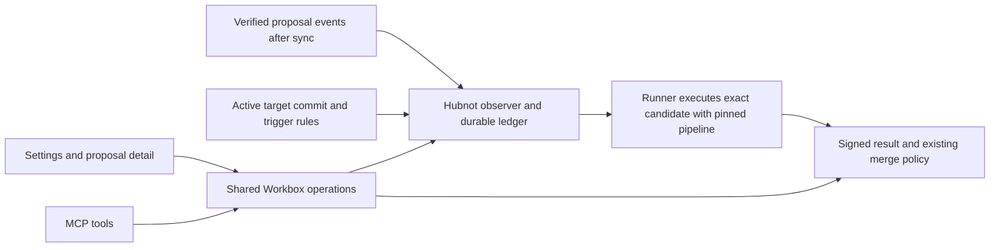

# Implementation Plan: Automatic proposal checks

**Branch**: `codex/automatic-proposal-checks` | **Mission**: `automatic-proposal-checks-01M78W2C` | **Spec**: [spec.md](spec.md)

## Summary

Hubnot owns observation, scheduling, execution and signed evidence. Workbox Settings and proposal detail consume the same native contract as Workbox MCP. Existing manual requests keep their behavior. Repositories opt in through committed trigger configuration and an explicitly enabled runner.

## Technical Context

**Language/Version**: Go for Hubnot and TypeScript, React and Next.js for Workbox, as pinned in their respective repositories.
**Primary Dependencies**: Existing Hubnot native runner, Git, Linux Bubblewrap and the Workbox Settings and MCP services.

- **Hubnot**: `runner.go` already polls after sync for signed manual requests. `lineage.go` resolves candidate ancestry, `ci.go` validates, executes and signs results, and `policy.go` evaluates pipeline evidence. Manual execution and policy currently resolve definitions at the candidate head. The automatic path must change both execution and evidence evaluation together.
- **Workbox**: `settings-operations.ts`, `pipeline-draft.ts`, `pipeline-review.ts` and `settings-submit.ts` provide the Settings seams. `proposal-checks.ts` projects native evidence for proposal detail. Extend the same shared services used by the browser and MCP in `mcp/server.ts`.
- **Baseline**: Workbox main at `f0db4ef`. Hubnot native work ships before Workbox enables the new capability. Feature detection is explicit and older binaries report unavailable. No GitHub service, Workbox page visit, or timer in the web process is required.

## Design

### 1. Commit and activate trigger configuration (FR-002, FR-006, FR-008)

Use one optional, versioned repository file, `.hn/proposal-checks.json`, with a map of pipeline names to event lists. The event vocabulary is `proposal.open` and `proposal.revision`. An empty list disables a pipeline. Missing file means all triggers disabled. Use strict decoding that detects repeated keys and event values before normalization. Validate pipeline references against the complete proposed tree, including definitions changed or deleted in the same draft. Hubnot owns the validator and canonical serialization. Workbox renders the exact bytes, file operations and diff it receives.

Read active rules from the configured canonical target ref already used for repository Settings. Pin the resolved target commit once for a coherent observation, verify governed activation through Hubnot, and record the commit and trigger blob digest in every decision. A contribution branch, uncommitted file or proposal content cannot activate its own rules. Settings may propose a combined pipeline and trigger change through the existing exact-candidate publication seam, preserving reviewed base, actor and operation key. Recheck them on submission. Preview and validation are read-only and neither start runners nor write Git refs or durable drafts. Keep Go starter `test` available as a selectable pipeline without enabling triggers on creation.

### 2. Observe verified events and reconcile durable checks (FR-001, FR-004, FR-007)

Extend the native runner poll after sync. Read authenticated, admitted proposal opens and revisions with Hubnot lineage semantics. Compare a revision's code commit to its predecessor. Comments, reviews, metadata-only revisions and repeated delivery cannot schedule. Candidate metadata may be observed before code objects arrive. Record a waiting decision with the configuration active at first observation and retry prerequisites independently.

Use a persistent ledger for the configured execution authority, keyed by a stable repository identity, proposal lineage ID, exact candidate event ID and pipeline name. Store the candidate commit separately. Persist the verified event observation, configuration snapshot and check decision in one transaction. On first opt-in, seed a baseline of already visible eligible events before the first scheduling pass, recording exclusions durably. Observe even with triggers disabled, so re-enabling does not replay events already seen. Newly synced verified events after activation qualify under the configuration at first admission into the observer, irrespective of author timestamp. Previously unseen events received after activation can qualify even if authored earlier. Establish the baseline with a coherent ref snapshot before the first post-activation sync so a proposal arriving during sync is not accidentally seeded as historical. If verification or activation is incomplete, defer the affected decision and retain the pinned observation for reconciliation. Never advance past an unverified scan as though it succeeded.

All observers for one authority must share its ledger and atomic claims. Initially support one configured execution authority per repository, with concurrent workers only against that same store. Other clones can produce and sync proposal events. They do not independently schedule the same repository. Document the recovery and migration procedure for this authority and refuse to initialize a second authority against an existing repository registration. Claim attempts transactionally, use expiring leases with fencing, and recover signed events by their operation identity before issuing any replacement. A crash before signed publication can leave an interrupted attempt, which remains visible. Claiming work provides one logical check and one accepted publication per attempt even if a worker is interrupted. No claim of exactly-once process execution across an unobservable crash.

### 3. Execute and publish exact evidence (FR-002–FR-005)

Bind each automatic request to candidate event and code commit, trusted definition source commit and digest, active trigger digest, pipeline, logical check identity and attempt identity. Add a versioned native request/evidence variant with authenticated binding. Reject missing or inconsistent provenance. Load the exact definition from the trusted source and extract the exact candidate tree separately. Publish via signed Hubnot run evidence with bounded run details. Reconcile publication before updating the ledger after any ambiguous failure.

Gate automatic execution on explicit runner opt-in, repository authorization where required, and an actual isolation capability check. First target Linux with the existing Bubblewrap backend after verifying the full boundary. Use a disposable candidate workspace and a fresh environment. Keep signing, credentials and unrelated repositories outside execution. No host backend fallback. Unsupported or unavailable environments surface a blocked reason and next action. Exercise the Go starter with the expected toolchain and offline dependency setup. Full OS qualification belongs to release.

Extend Hubnot policy to distinguish automatic evidence with authenticated trusted-definition provenance from existing manual evidence. For automatic results, verify authorization, request/result linkage and exact revision, code, definition and attempt before using existing policy outcome rules. Check both read-only policy status and merge authorization through the same evaluator. Preserve existing policy thresholds and manual candidate-head definition semantics. Optional failures stay visible without acquiring new blocking power.

### 4. Expose shared Settings and check operations (FR-004, FR-006)

Extend Settings with active configuration and its source revision, editable toggles per pipeline, read-only draft validation and exact multi-file diff, plus explicit governed proposal submission. Carry the same draft through Graph and JSON pipeline edits. Surface stale-base and uncertain-submission recovery through the existing reviewed operation key. Expose corresponding typed MCP operations backed by the same validator, preview, permissions and mutation service.

Extend proposal detail and its MCP counterpart with the same exact-revision check model. Include pipeline, configuration source, definition digest, status/reason, timestamps, attempt history, available signed evidence and run details. Distinguish ineligible, waiting, queued, running, passed, failed and canceled where applicable. For non-authority instances, show native availability and signed evidence when available. Use the same authority query in both transports for transient state. If explicit retry is exposed, authorize it in Hubnot, bind it to the original check and reviewed request, return the resulting distinct attempt and make transport retries idempotent. Use no client-side policy or scheduler logic.

## Delivery sequence

1. Define the Hubnot trigger and native evidence contracts, capability advertisement and compatibility fixtures. Establish isolation preflight before enabling execution.
2. Implement and verify authority registration, observation, activation baseline, durable scheduling and restart recovery. Add authenticated pinned-definition execution and policy recognition.
3. Extend Workbox Settings and MCP together, including combined draft validation and exact reviewed submission.
4. Extend proposal detail and MCP together. Verify full lifecycle on a Linux execution authority with a real synced clone and a real runner. Release Hubnot capability first and enable Workbox support once it is available.

## Verification

| Requirements | Acceptance coverage |
| --- | --- |
| FR-001, FR-007 | Browser, CLI and sync entry paths. Initial baseline, same-head replay, metadata event, disabled interval, late sync, restart and overlapping observer fixtures. Failpoints around observation, claim and signed publication. |
| FR-002, FR-003 | Candidate changes its own trigger and definition, but runs the active definition against the candidate code. Verify unavailable or unauthorized runner reporting and capability fail-closed behavior. |
| FR-004, FR-005 | Older and untrusted evidence remain visible where appropriate and cannot satisfy the selected revision. Compare policy status and merge authorization for optional and required pipelines. Verify waiting recovery and attempt history. |
| FR-006, FR-008 | Browser/MCP contract tests compare active rules, Go starter selection, combined draft errors, exact diff, permissions, submitted bytes and selected-revision details. Assert read-only operations leave refs and scheduling state unchanged. |

Use Hubnot native and multi-clone integration fixtures first, then production Workbox browser and MCP tests against that build. Exercise an older binary, missing configuration, a malformed configuration and unavailable execution authority. Keep the full OS matrix for release qualification.
