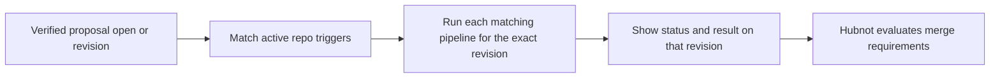

# Mission Specification: Automatic proposal checks

**Mission Branch**: `codex/automatic-proposal-checks`  
**Created**: 2026-11-12  
**Status**: Draft

When a Hubnot proposal opens or receives a new code revision, run the pipelines that the repository has configured for that event. Show developers and agents which checks ran for the revision they are reviewing and what is still blocking it.

## User scenarios and acceptance

### Review a proposal with automatic checks

1. Given a repository with an eligible runner and a pipeline enabled for both events, opening a proposal queues that pipeline for the opening revision. Publishing a new revision queues it again for the new revision.
2. Given different pipelines enabled for open and revision events, only the pipelines enabled for the event run. Comments, approvals, metadata edits, and republishing the same revision do not create new automatic runs.
3. Given a run still in progress for an older revision, publishing a new revision gives the new revision its own check status. The earlier result remains visible on its own revision and cannot satisfy the new revision's merge requirements.
4. Given a qualifying proposal opened through Workbox, the Hubnot CLI, or another clone and then synced into the configured execution environment, the same trigger rules apply once the verified event and revision are available.
5. Given an eligible check that cannot start because its revision or runner is unavailable, the proposal shows the reason and the next action. Once prerequisites return, the pending check can start without opening a new proposal.

### Configure triggers in Settings or over MCP

1. Given a repository with committed pipelines, a maintainer can inspect which pipelines run on proposal open and on new revision, toggle each event independently per pipeline, and disable both.
2. Given a draft trigger change, browser and MCP expose the same active configuration, draft validation, diagnostics, exact diff, and explicit proposal submission. Drafting and validating neither write repository state nor schedule checks. A submitted draft takes effect when its configuration becomes active through normal Hubnot governance.
3. Given a draft that points to a missing pipeline, duplicates a trigger, or uses an unsupported event, both surfaces explain the same validation failure. Trigger changes and pipeline changes in the same draft can be reviewed against the same proposed configuration.
4. Given a repository without trigger configuration, no automatic runs are scheduled. Enabling triggers applies to new eligible events, including those received later by sync, without sweeping historical proposals. The effective configuration and its revision are inspectable.

### Diagnose and recover a check

1. Given duplicate delivery, concurrent observers, or restart after scheduling, the same proposal revision and pipeline have one logical automatic check. Its status survives restart, and a prior result is not silently replaced by a repeat delivery.
2. Given a failed check or interrupted runner, browser and MCP show the same status, reason, exact revision, pipeline, and available run details. An explicit retry, where supported by existing permissions and runner capabilities, creates a distinct attempt on the same revision and is visible in its history.
3. Given an optional pipeline that fails, the result is visible. Only existing Hubnot policy determines whether that failure blocks merge.

## Requirements

- **FR-001** Evaluate verified Hubnot proposal opens and revisions that introduce a new code revision. Identify checks by repository, proposal, exact revision, and pipeline, with separate attempt identity for retries. Manual runs remain available.
- **FR-002** Use the active repository trigger rules and trusted committed pipeline definition for a scheduled check. Record which configuration and definition were used. Execute against the exact proposed code revision. A proposal cannot activate its own triggers or replace the pipeline definition used to check it before governance activates that change.
- **FR-003** Use a runner explicitly enabled for automatic proposal checks and authorized by repository policy where required. Keep proposal execution isolated from the runner's signing identity, unrelated repositories, and ambient credentials. If the environment cannot provide the required execution boundary, show a blocked check with a reason.
- **FR-004** Distinguish waiting, queued, running, passed, failed, and canceled states where applicable. Show the exact revision, pipeline, attempt, and available timestamps, result, and run details in proposal detail and MCP. Make skipped or ineligible cases distinguishable from a pending check.
- **FR-005** Submit results through Hubnot's existing trust model. A queued check, an unsigned or untrusted result, or a result for another revision cannot satisfy a governed pipeline requirement.
- **FR-006** Expose browser and MCP parity for reading trigger configuration, editing drafts, validating, reviewing exact changes, proposing updates, inspecting revision checks and attempts, and any explicit retry action offered in the browser. Use the same authorization and validation rules.
- **FR-007** Continue evaluating checks independently of whether anyone has Workbox open. Recover from restarts and duplicate events without losing pending work or silently scheduling duplicate runs. Disabling a trigger affects future scheduling. Already queued or running checks retain the configuration under which they were scheduled.
- **FR-008** Allow the Go starter's existing `test` pipeline to be selected for either trigger. Repositories choose which pipelines run and when.

## Scope and planning decisions

The first pass covers proposal open and new revision events, repository-wide rules per pipeline, and revision check status. Branch and path filters, schedules, matrix execution, GitHub Actions import, and hosted runner provisioning are outside this mission. Changing policy requirements continues through Hubnot's governance flow.

Planning must resolve where Hubnot observes and durably schedules events, how it establishes the activation boundary for synced events without relying on proposal-author clocks, and which supported execution environments can enable automatic checks. Full OS testing belongs to release qualification.

## Success criteria

- Both proposal events produce the expected check set under independent trigger settings, including events delivered by sync.
- Duplicate delivery and restart produce one logical automatic check per revision and pipeline. No older revision result satisfies the latest revision's policy.
- A maintainer can make and review the same trigger change through Settings and MCP, and both surfaces report the same status and run details for the same revision.
- Missing prerequisites surface an actionable status. A proposed pipeline change cannot alter the trusted definition used for its own automatic check.
