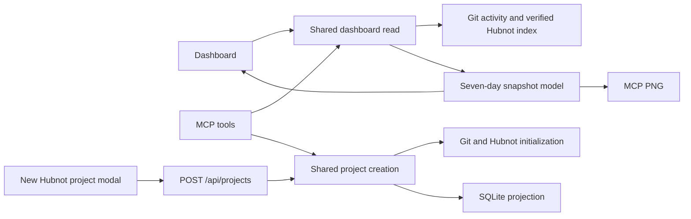

# Dashboard cleanup implementation plan

**Branch** `feat/dashboard-cleanup` · **Spec** [spec.md](spec.md) · **Interfaces** [dashboard.md](contracts/dashboard.md)

## Dashboard and snapshot

- Extract a shared dashboard reader from `src/app/page.tsx`, using the existing `instanceStats`, `recentActivity`, and `recentProjects` behavior. Capture one reporting time for the rolling seven-day window and take summary, feed, and indexed activity reads from the same SQLite snapshot. Keep Git reads bounded and reuse the current Git eligibility and Hubnot visibility checks. Keep the top-ten ranking and its tie-breakers, including the current treatment of projects whose latest observed activity precedes the window.
- Carry the source coverage already available from the activity collectors into the shared model, including when limited visibility could affect ranking or totals. Preserve observed counts with an incomplete indicator and distinguish a known zero from unknown activity. Each row carries its Git and Hubnot counts, the latest available activity, and an encoded project link.
- Keep the dashboard's compact visual and readable counts. Reuse the locally bundled chart-rendering path for an MCP PNG with the same ranked projects, count scale, source labels, reporting window, and coverage. Use the same model for the browser and MCP. Preserve the existing feed limit and link each entry to the same destination on both surfaces.
- Remove the all-projects query and sidebar from the page and let the feed fill the available width. Keep the Explore link in the header. The existing Explore route and MCP catalog reads remain the way to browse all projects.

## Project creation

- Wrap the existing form in a Radix Dialog styled with Workbox tokens. Put the trigger in the dashboard header. Give the dialog a title, label each field, focus the first field on open, and restore focus to the trigger on dismissal. Announce validation and creation results. Keep values on failure and show an **Open project** link after success. Protect against duplicate submit while a request is pending. Closing before submission discards the draft and makes no request.
- Make the HTTP route and the new MCP creation tool call one server-side operation. Normalize and validate ID, name, and description there. Keep existing ID rules and name defaults. Only an explicit POST or tool call invokes creation. Preserve the Git initialization, Hubnot identity, governance commit, and founding signed issue from `src/lib/workbox/create.ts`.
- Replace the existence check followed by recursive directory creation with an exclusive claim of the final project directory. Treat a preexisting path, including an empty directory or symlink, as a conflict. Record attempt ownership and phase in private state. Keep unfinished initialization out of discovery while the attempt is active. Cleanup is limited to the directory proven to belong to the failed attempt. If cleanup cannot finish or an attempt is interrupted, preserve it for inspection and report a recovery-required result. Never take over an ambiguous or existing directory.
- Once the signed repository is complete, retain it if indexing fails. Record that phase before indexing. Confirm the indexed project and verified founding issue before reporting success. An explicit retry with the same normalized inputs may recover a known indexing failure by re-indexing only, after verifying the attempt state and taking an exclusive recovery claim. A mismatched or unowned directory stays a conflict. If the phase cannot be verified, give the operator recovery instructions. SQLite and the filesystem can fail independently, so do not claim transactionality across them.

## MCP and verification

- Register dashboard and project creation tools in `mcp/server.ts`. The dashboard returns public JSON and standard PNG image content. Creation returns the same public outcome fields as HTTP, with controlled error categories and recovery guidance. Preserve existing MCP tools and their output contracts. Use the same local project access rules on both surfaces.
- Add a parity fixture that drives production HTTP and the actual MCP stdio server against disposable roots and indexes. Compare dashboard order, counts, coverage, feed and links for busy, empty, and incomplete cases. Exercise valid creation, malformed input, preexisting targets, concurrent browser and MCP submissions, initialization failure, and indexing recovery. Verify the actual signed founding issue after success.
- Verify browser keyboard and narrow-layout behavior, including modal focus, dismissal, submit, failure, success, and the sidebar removal. Run scoped ESLint, TypeScript, the production build, focused tests, and relevant existing MCP regression checks. Release OS testing is deferred.
- No SQLite schema migration is required. Verify the feature on a separate loopback port with a disposable index before updating the running Workbox instance as a separate rollout step.
