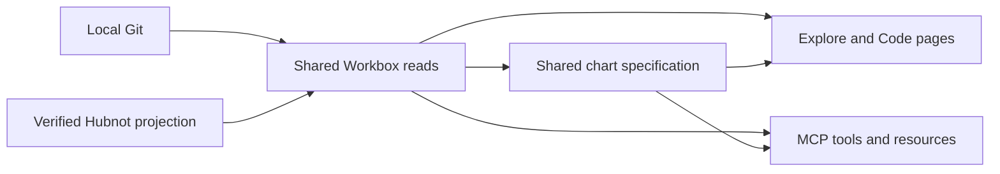

# Explore and repository Code implementation plan

**Branch** `feat/explore-code-parity` · **Spec** [spec.md](spec.md)

The branch starts from current main, with the existing Recently Active feature brought in at `5633ad5`. Reuse its activity eligibility and retain its dashboard entry point. Add chart data, repository metadata, and drill-downs as typed reads behind both the Next.js pages and Workbox MCP server. [Read contract](contracts/reads.md)

## Delivery

1. Establish shared chart types, strict query parsing and URL helpers. Use Apache ECharts with selective imports and a common option builder for the interactive browser chart and locally generated MCP image. Share explicit UTC buckets, labels, legend, units, and selection. Offer keyboard-operable dates alongside the visual. Use Octicons for repository controls and rows. Keep Tailwind and existing tokens. The first pass can use native form controls.
2. Build Explore from indexed projects and the existing activity readers. Apply the same search and visibility to the chart and list, then use deterministic sort and numbered pages. Fetch seven-day Git activity without launching more subprocesses than the current Explore ranking requires. Track unavailable source coverage separately from empty results. When a repository has contribution authority or its Git metadata cannot establish the local visibility mode, omit raw projected Hubnot facts from Explore and mark its Hubnot coverage incomplete.
3. Add a pinned repository tree reader and commit/file detail. Resolve a branch once, then use the full Git commit for the tree, row metadata and links. Parse Git's NUL-delimited paths, associate descendant changes with directory rows, and avoid one log per entry. Bound history reads and report incomplete results. Keep existing project tabs and the Code sidebar.
4. Add the repository calendar with Git commits and the verified issue, proposal, and CI event families in the contract. Use an independently resolved default branch for the commit metric. Use the same rows for buckets and daily records. For governed repositories, resolve visibility through bounded exact Hubnot reads. Exclude unavailable evidence and report incomplete coverage. Keep Code layout ownership separate from the calendar component.
5. Register the shared reads and chart outputs in MCP, wire the Code page to the calendar, and exercise both actual interfaces against one disposable fixture. Keep existing MCP tools and sanitizer behavior compatible. Validate inputs and construct public results from explicit fields. Never expose repository filesystem paths or native diagnostics.

For snapshot comparison, capture the effective query and source data together within each response. Pin Git reads by object ID and use a SQLite read transaction for verified projection data. Derive a deterministic activity snapshot ID from the eligible record set and reporting date. Return it to both interfaces. Carry it into page and drill-down requests, and report a stale selection with a refresh link when recomputation detects a different snapshot. The live Workbox server and user repositories are outside the test setup.

The first pass needs no schema migration. Cache policy and indexing changes can follow measured costs. Use the current SQLite projection and existing visibility mechanisms. Render chart data and labels from typed results and use the same eligible records for totals and drill-downs.

## Verification

Run focused domain fixtures and a production-backed browser/MCP parity fixture with 43 projects, controlled Git history, two branches, files and directories, and verified and unverified events. Exercise all metrics and stale or partial histories. Verify the MCP visual is usable alongside the underlying data. Run scoped ESLint, TypeScript, and the Next.js production build. Verify the existing MCP self-test where its fixture is available. Release OS qualification remains separate.
