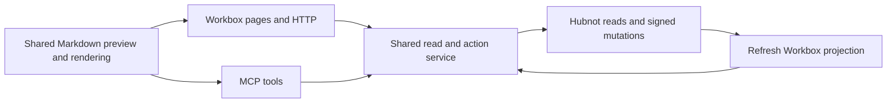

# Implementation plan for Issues and Discussions

Branch `codex/issues-and-discussions` · [Specification](spec.md)

## Summary

Build complete browser journeys for Issues and Discussions on a shared Workbox service. HTTP and MCP will adapt requests to the same service, which delegates signed actions and conflict handling to Hubnot. Add a shared Markdown composer and renderer for both journeys, with reuse in guided proposal creation.

## Technical Context

**Language/Version**: TypeScript in the existing Next.js App Router and Node runtime. Hubnot native commands remain the Go boundary.
**Primary Dependencies**: Existing Next.js, React, Zod, Hubnot runner and MCP stdio transport. Select a Markdown parser with raw HTML disabled and an explicit safe-link policy.
**Storage**: Hubnot signed Git events are canonical. Workbox SQLite holds rebuildable projections and stable local issue numbering.
**Testing**: Native command fixtures, shared service integration tests, browser and MCP parity tests, and focused browser keyboard and form tests.
**Target Platform**: Existing Workbox deployment targets. Full OS qualification remains a release activity.

## Charter Check

The local project charter is unavailable. Preserve the specification's browser/MCP parity, Hubnot authorization, and signed provenance. Spec Kitty planning and commits run locally.

## Architecture

- **Shared service and adapters.** Add resource modules under `src/lib/workbox` and reuse `src/lib/hn/runner.ts`. Validate resource IDs, fields, filters, cursors, expected revisions, actor selection, and operation IDs in shared schemas. Next route handlers and `mcp/server.ts` map the same typed outcome into their transport. Preserve the existing issue tools, links, and response fields through compatibility adapters. Move their current separate signing paths behind the shared service.
- **Identity and permissions.** Resolve available actors through the existing identity integration and scope choices to the identities this instance permits the caller to use. Never accept a fingerprint alone as proof of permission. Give both surfaces the same available actions and reasons using native capability information where present. Hubnot revalidates actor, expected revision, and authorization at submission. Document the command and envelope contract against the installed and supported Hubnot versions before implementing controls. Confirm the native capability for issue comment editing, deletion, and additional moderation. Scope native changes for required actions that lack support.
- **Retries and concurrency.** Generate one operation ID per intentional submission and keep it through uncertain retries. Use Hubnot operation lookup and replay semantics. Return the canonical resource ID and signed revision from the command result, then refresh the projection. If signing succeeds and indexing fails, report both states and retry the refresh without another mutation. For stale or conflicting heads, return current revisions, keep draft source, and require deliberate review before resubmission.
- **Reads and migration.** Reuse issue projections and local numbers, reconciling them with verified native reads for revision history and conflicts. Build discussion list and detail from verified thread and reply state, using native paged reads for authoritative content and cursor semantics. Keep reply roots separate from reply revision IDs so the accepted answer stays pinned when a reply is edited. Add rebuildable projection fields only where necessary for filtering and navigation. Test existing synced and legacy data, partial history, and missing native capabilities.
- **Markdown.** Share a keyboard-accessible Write/Preview composer under `src/components` and a pure rendering policy used by preview, detail pages, and MCP preview. Support headings, emphasis, links, lists, quotes and fenced code. Preserve source exactly across edits and transport, including syntax outside toolbar coverage. Disable raw HTML execution and allow only approved link schemes. Keep per-resource draft state on validation, stale-write, permission, and network failures. Return the same Markdown source and equivalent preview content over MCP.

## Delivery sequence

1. Verify the Hubnot read, actor, mutation, and recovery contracts with fixtures for signed, legacy, conflicting, and synced resources. Define shared schemas, action availability, error mapping, and compatibility behavior.
2. Build the shared Markdown composer and rendering policy. Exercise keyboard controls, round-trip fidelity, and unsafe markup handling before using it in forms.
3. Deliver Issues from filtered list through detail, create, comment, edit, labels, close/reopen, and authorized conflict resolution. Wire browser and MCP to the shared service for each action.
4. Deliver Discussions from categorized list through thread creation, contextual replies, edits, category changes, close/reopen, exact-revision answers, and authorized conflict resolution. Verify browser/MCP parity before completion.
5. Run both end-to-end journeys against the same signed fixtures. Cover permission denial, stale revisions, duplicate submissions, indexing recovery, equivalent pagination and filters, and stable links. Use a fresh user journey from list to signed outcome to verify that terminal commands are unnecessary.

## Follow-up for commit and proposal diffs

The reported Fell Into commit page lists five added files for `dbc8063591c62b356b6cd42024bbcbff40ca492b`. Git records 304 added lines, but the commit page only renders the changed file list. Proposals already provide a per-file patch after selecting a file.

- Give commit detail a visible diff by default, with a changed file summary and expandable per-file hunks. Compare the pinned commit to its first parent by default, offer parent selection for merges, and compare root commits to the empty tree. Retain existing commit deep links and add stable links to individual files.
- Give proposal detail a discoverable **Files changed** entry with per-file hunks and revision context. Reuse the existing exact comparison contract and bounded patch reader where possible. The diff must reflect the selected proposal revision even after the branch advances.
- Share the file list and patch presentation where practical. Render old and new line numbers, context, additions, and deletions. Distinguish renames, binary files, empty changes, missing objects, and truncated output. Preserve bounded reads and expose the same comparison inputs, file summaries, patch text and status over MCP.
- Use the reported commit as a regression case and fixtures for deleted and renamed files, merge and root commits, and older proposal revisions. Validate that the landing view shows an actual hunk when text changes exist and that browser and MCP report the same comparison.
- Sequence this follow-up alongside guided proposal creation after Issues and Discussions. Guided creation uses branch dropdowns and a pre-submission comparison. Existing commit and proposal detail views also need their own diffs for changes opened elsewhere.
