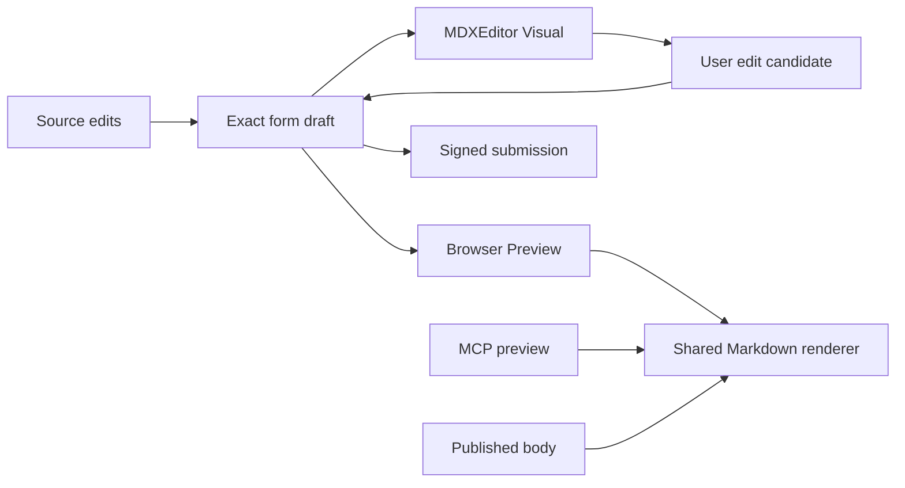

# MDXEditor implementation plan

Branch `codex/mdxeditor-upgrade` · [Specification](spec.md)

## Summary

Add MDXEditor as the default Visual mode in the shared composer. Keep the form-owned Markdown string as the canonical draft for Source, Preview, and submission. Verify the exact source through native signing and through both preview transports.

## Technical Context

**Language/Version**: TypeScript, React and Next.js App Router as pinned by Workbox.
**Primary Dependencies**: Add `@mdxeditor/editor` with a pinned lockfile. Retain the existing MarkdownIt renderer and Zod preview schema.
**Storage**: Plain Markdown in existing form drafts and Hubnot signed records. No data migration is required.
**Testing**: Focused state tests, production browser and MCP integration tests, and native signing fixtures.

## Draft and mode boundaries

- In `src/components/markdown-editor.tsx`, preserve the controlled composer contract. Add a client-only dynamically loaded Visual component and initialize its plugins inside that boundary. Use Markdown plugins for headings, links, lists, quotes, tables and fenced code. Disable HTML processing and omit executable MDX features. Preserve accessible labels, keyboard navigation, focus and disabled behavior in every mode.
- Capture the exact source on entry to Visual. Track the editor's serialized baseline separately. Ignore initialization normalization, programmatic hydration, mode changes, and obsolete callbacks from a previous import. Use documented editor methods for explicit source updates. Do not feed each change back through the initial value prop. [MDXEditor setup](https://mdxeditor.dev/editor/docs/getting-started) · [Editor callbacks and options](https://mdxeditor.dev/editor/api/interfaces/MDXEditorProps)
- Publish a visual candidate to the form only after a user edit. Compare the original source with its no-op serialization to identify normalization independent of the edit. If normalization could affect unrelated source, show the exact candidate in Source and require explicit review before submission. Retain the original until the candidate is accepted. Treat unknown, lossy, or unsafe imports as Source fallback, retain the original bytes, and allow Visual to be retried after a Source edit. Prototype callback timing and import/export behavior against the pinned package before wiring the forms. [MDXEditor import errors](https://mdxeditor.dev/editor/docs/error-handling)
- Keep the existing Source textarea normalization handling for mixed line endings. Entering Preview sends the current source to `POST /api/markdown` and discards stale responses. That route and `workbox_preview_markdown` call the existing `previewMarkdown` function. Published content uses its renderer. Keep raw HTML inert and enforce the shared link policy for preview and published content. Validate links and pasted content in Visual as well.

## Integration and rollout

1. Verify the pinned library in the repository's production Next build. Test initialization, programmatic replacement, user edits, tables, code, unsupported nodes, and normalization. Use the results to settle the adapter and fallback behavior.
2. Implement the shared mode controller and Visual component. Keep Visual as the starting mode for supported drafts. Ensure that a loading or import failure still leaves Source and Preview accessible.
3. Wire the existing issue and discussion forms to the composer. Preserve revision binding, pending operation IDs, draft recovery, and exact payloads. Give the existing proposal form an explicit Markdown field in `src/components/create-form.tsx`. Remove description trimming from its route and check the native open path for further normalization and safe replay support. Reuse the existing native exact publication seam where needed to satisfy the spec. Keep branch selection and comparison outside this editor change.
4. Check the same exact source through browser Preview, MCP, published rendering and signed payloads. Keep existing Markdown readable and editable across rollout. Full OS testing belongs to release qualification.

## Verification

| Requirement | Evidence |
| --- | --- |
| FR-001 | Production browser test opens each form in Visual, applies formatting with keyboard and toolbar, and checks focus across modes. |
| FR-002 and FR-003 | Cycle modes and preview mixed CRLF/LF, Unicode, trailing spaces, and no final newline. Compare original, submitted, and signed body bytes after an unrelated edit. Test Source edits and an intentional Visual edit with normalization review. |
| FR-004 | Exercise unsupported and failed imports, programmatic draft replacement, and late callbacks. Check that the exact draft survives and Source and Preview remain usable. |
| FR-005 | Send identical input over production HTTP and MCP. Compare exact source and HTML for code, tables, Unicode, raw HTML, unsafe links, and inert MDX syntax. Verify published output matches. |
| FR-006 | Exercise stale revisions and lost responses, including after a mode switch. Compare the exact retry payload and operation ID, and verify only one signed event. |
